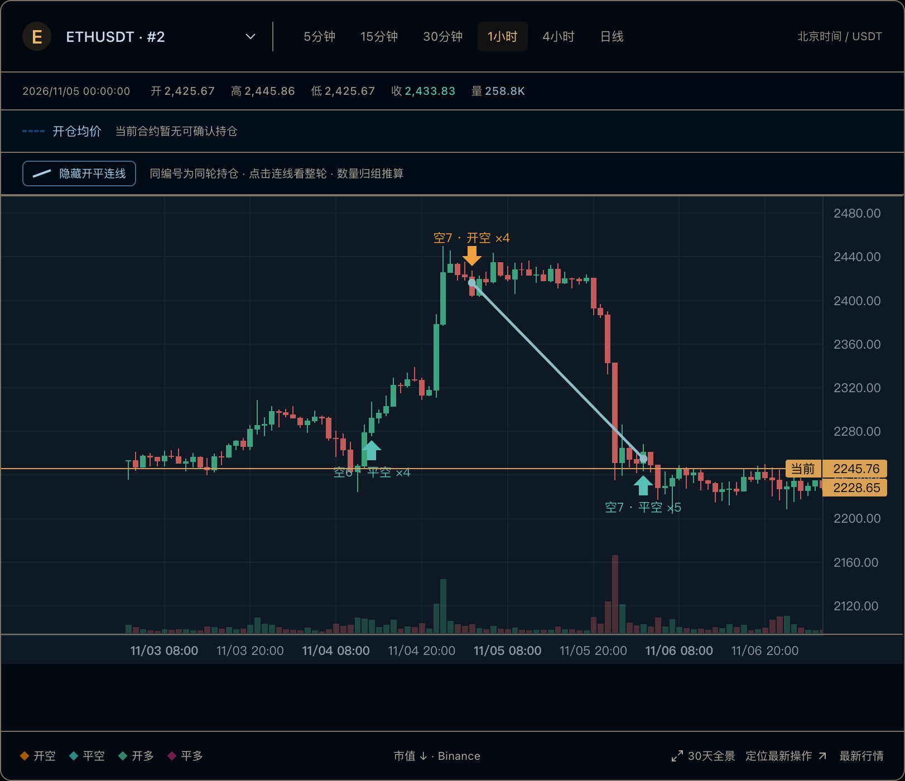

# TRADER WATCH 图文复盘指南

币安带单交易员公开记录观察与 K 线复盘。这里整理免费工具的使用方法、KOL 复盘清单、熬鹰历史案例和可下载数据。

[打开观察台](https://bn.9987620.xyz/) · [网站文章](https://bn.9987620.xyz/articles) · [使用指南](https://bn.9987620.xyz/guide) · [数据方法](https://bn.9987620.xyz/methodology)

## 从一次完整复盘开始

选择交易员和合约，把开仓、加仓与分批平仓放回同一张 K 线。点击同轮编号查看整轮，再用操作流水核对精确时间、数量和成交均价。

网站实图截于 2026-11-07。图中的行情和状态属于截图时刻。点击图片可以查看完整尺寸。

## 图文文章

- [BN交易员免费跟单怎么理解？先用K线复盘看清记录](articles/bn-free-copy-trading-review.md)

  搜索交易员跟单免费、BN交易员免费跟单时，先分清免费信息、免费复盘工具和实际跟单交易。用公开成交记录检查开平仓，再决定还需要了解什么。

- [KOL复盘怎么做？跟单前先核对这6项交易记录](articles/kol-trade-review-checklist.md)

  KOL复盘不只看收益截图。用项目身份、数据覆盖、开平仓数量、加仓路径、行情时间和可重复记录六项清单，完成一次可核对的交易复盘。

- [熬鹰K线复盘，47.241 BTC开空记录之后，还发生了什么？](articles/aoying-kline-review-btc-202610.md)

  以熬鹰资本2026年10月的BTCUSDT公开成交存档为例，核对两笔开空和一笔平空，说明为什么不能仅凭一条开仓记录推断当前持仓。

- [K线复盘怎么做？把开仓、加仓和分批平仓连起来](articles/kline-review-entry-exit-connections.md)

  用同轮编号与开平仓连线做K线复盘，区分开仓价、加权均价、分批平仓与当前报价，并按交易持续时间选择5分钟至日线周期。

- [看到开空就代表还持仓？跟单复盘里的5个常见误区](articles/copy-trader-position-history-mistakes.md)

  解释公开仓位查询、操作流水、部分平仓与全平记录的区别。用具体数量说明为什么最新开仓、单笔平仓和空列表都不能单独证明当前持仓。

## 固定案例

[下载熬鹰 BTC 三条公开成交 CSV](examples/aoying-btc-202610.csv)

北京时间 2026-10-10 的两笔开空分别为 48.971 BTC 和 47.241 BTC，合计 96.212 BTC。存档中 2026-10-23 的一笔平空为 96.212 BTC。案例只讨论这组三条历史记录的数量关系，适用范围以文章说明为准。

## 数据与截图

材料来自币安公开带单记录及 TRADER WATCH 保存的公开记录。持仓结论需要结合合约、方向、可靠起点、历史覆盖和查询截止时间阅读。本站由独立项目维护，免费提供公开记录观察与复盘。

## English overview

TRADER WATCH is an independent public Binance copy-trader monitoring and trade-review tool. These illustrated Chinese guides cover public execution history, K-line entry/exit connections, a historical BTC case, and quantity-based position reconstruction. Each article includes its sources and a link to the maintained website version.

Topics include Binance trader monitoring, copy-trading research, KOL trade review, candlestick trade replay, entry and exit visualization, and public position reconstruction.
