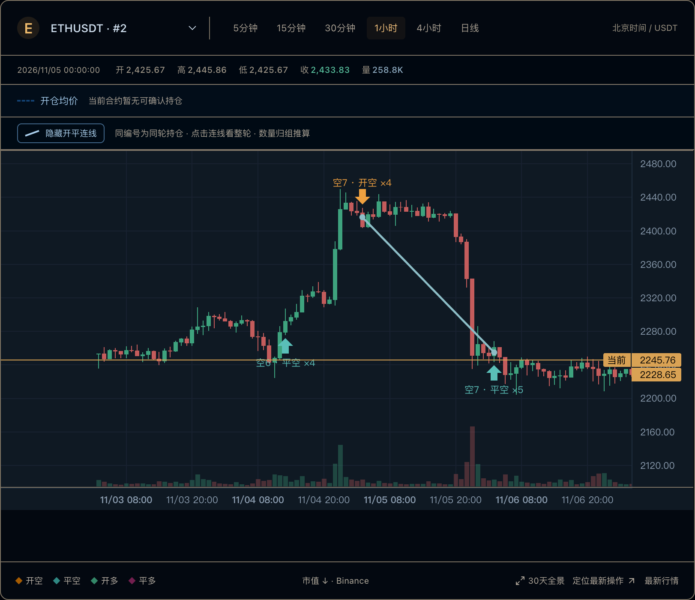

# 币安交易员监控与 K 线复盘 · TRADER WATCH

**Binance Copy Trading Review · Public Trade History · KOL Trade Replay**

TRADER WATCH（币安交易员观察台）是一个独立的免费网页工具：添加币安带单交易员的主页链接，就能查看其公开开平仓流水、在 5m–1d 六种周期 K 线上标注买卖点、按已覆盖记录及查询截止时间推算持仓并导出 CSV。不需要个人币安 API 密钥，不自动跟单、不下单。

本仓库整理图文教程、KOL 复盘清单、熬鹰资本 BTC 历史案例、工具对比、术语表、网站实图和可下载 CSV。每篇文章保留来源、观察区间与网站原文，方便收藏和复查。

[打开币安交易员监控](https://bn.9987620.xyz/) · [阅读网站图文](https://bn.9987620.xyz/articles) · [交易员公开记录](https://bn.9987620.xyz/traders) · [工具对比](https://bn.9987620.xyz/compare) · [术语表](https://bn.9987620.xyz/glossary) · [RSS订阅](https://bn.9987620.xyz/feed.xml) · [Discord社群](https://discord.gg/NjXEW6mdDG) · [使用指南](https://bn.9987620.xyz/guide) · [数据与推算方法](https://bn.9987620.xyz/methodology)

网站实图截于 2026-11-07。截图中的行情和状态属于该时刻，点击图片可查看原尺寸。

## 这个工具可以做什么？

| 复盘需求 | 网页功能 | 核对依据 |
| --- | --- | --- |
| 监控多个带单交易员 | 粘贴币安带单主页链接或项目 ID，自定义添加目标 | 每个项目分别保存成交与提醒 |
| 查看开平仓记录 | 按交易员、合约和操作类型查看公开流水 | 成交时间、BUY/SELL、多空方向、数量与均价 |
| 做 K 线复盘 | 5m、15m、30m、1h、4h、1d 六种周期 | 成交标记与流水对应 |
| 看懂一轮加减仓 | 同轮编号与开平仓连线，点击定位整轮 | 同合约、同方向的数量累计关系 |
| 核对推算持仓 | 展示数量、推算开仓均价和持仓依据 | 可靠起点、累计开平数量、完整查询截止时间 |
| 补取历史与保存笔记 | 按日期分段补取，导出已保存流水 | 查询进度、区间覆盖和 CSV |
| 回看监控提醒 | 保存新成交、推算变化与采集异常记录 | 提醒时间和对应交易员 |

## 五步完成一次交易复盘

1. 打开观察台，在币安找到要观察的带单交易员主页，保存项目链接与 ID。
2. 点击“添加交易员”，粘贴主页链接或项目 ID，填写便于识别的名称。站点采用共享监控列表。
3. 等待采集后选择合约和 K 线周期，先查看完整查询截止时间与历史覆盖提示。
4. 点击流水中的同轮编号，把开仓、加仓、分批平仓放在一起，核对累计数量和成交均价。
5. 导出 CSV，保留截图、观察区间与尚待解释的问题，形成可继续核对的复盘笔记。

添加目标、日期补取与浏览器提醒的具体操作见使用指南。[查看完整步骤](https://bn.9987620.xyz/guide)

## 图文教程、工具对比与术语表

| 你想了解的内容 | 图文教程 |
| --- | --- |
| 跟单、交易员跟单免费、BN 交易员免费跟单 | [BN 交易员（币安带单员）免费跟单怎么理解？先用 K 线复盘看清记录](articles/bn-free-copy-trading-review.md) |
| KOL 喊单复盘、跟单前复盘、币安实盘记录核对 | [KOL 喊单复盘怎么做？跟单前先核对这 6 项公开交易记录](articles/kol-trade-review-checklist.md) |
| 熬鹰 K 线复盘、熬鹰资本 BTC 历史操作 | [47.241 BTC开空记录之后，还发生了什么？](articles/aoying-kline-review-btc-202610.md) |
| K 线复盘、开平仓连线、分批平仓 | [把开仓、加仓和分批平仓连起来](articles/kline-review-entry-exit-connections.md) |
| 币安交易员持仓查询、有仓与已平仓判断 | [怎样用公开记录判断有仓、已平仓与数据不足](articles/binance-trader-position-query.md) |
| 公开记录推算持仓、交易复盘误区 | [跟单复盘里的5个常见误区](articles/copy-trader-position-history-mistakes.md) |
| 币安带单监控工具哪个好、怎么选 | [5 个工具的用途、费用与官方来源（含核对日期）](articles/compare.md) |
| 带单员、公开流水、公开仓位、推算持仓、全平基线、同轮编号 | [术语表：看懂带单记录前先分清这 6 个词](articles/glossary.md) |

每篇 Markdown 文章开头都附有网站原文链接，网站文章区提供目录、来源与相关阅读。[查看全部图文](https://bn.9987620.xyz/articles)

## 订阅与保存图文

把 `https://bn.9987620.xyz/feed.xml` 添加到 RSS 阅读器，可以订阅图文更新。订阅条目包含摘要、网站实图和完整文章链接。

每篇网站文章提供“下载本文Markdown”，保留正文、表格、原图链接、发布日期和来源，方便保存复盘资料。HTML 原文地址写在 Markdown 开头，便于回到持续维护的版本。

[订阅RSS](https://bn.9987620.xyz/feed.xml) · [下载熬鹰案例Markdown](https://bn.9987620.xyz/articles/aoying-kline-review-btc-202610/markdown)

## 熬鹰资本 BTC 历史复盘案例

案例选取公开项目 `5075281354358777856` 的三条 BTCUSDT 存档记录，时间均为北京时间，核对日期为 2026-11-07。

| 北京时间 | 操作 | 数量 / BTC | 成交均价 / USDT |
| --- | --- | --- | --- |
| 2026-10-10 01:22:51 | 开空 | 48.971 | 82555.03138 |
| 2026-10-10 02:18:27 | 开空 | 47.241 | 82571.57634 |
| 2026-10-23 11:50:51 | 平空 | 96.212 | 81934.27588 |

两笔开空合计 `48.971 + 47.241 = 96.212 BTC`，随后存档记录到等量平空。这组三条记录内的开平数量归零。后续持仓需要继续核对新的操作、方向和查询截止时间。

[阅读完整案例与来源](articles/aoying-kline-review-btc-202610.md) · [下载固定案例 CSV](examples/aoying-btc-202610.csv) · [查看币安公开项目主页](https://www.binance.com/zh-CN/copy-trading/lead-details/5075281354358777856)

## 常见问题

### 币安带单交易员的持仓能直接查到吗？

不能直接查到此刻的真实仓位。能核对的是公开成交流水、平台在某一时刻披露的公开仓位，以及按数量推算的持仓；推算结论必须带查询截止时间，记录有缺口时显示“数据不足”。[三种信息的区别](articles/binance-trader-position-query.md)

### 搜索“BN交易员免费跟单”，这里免费的是什么？

TRADER WATCH 免费提供公开记录观察、交易员监控与 K 线复盘。实际跟单交易在交易所完成，交易费用、利润分成和可用条件按平台当前规则执行。[币安官方跟单说明](https://www.binance.com/en/support/faq/detail/6ed0995daf0b42d5816beaf1e31ca09d)

### 查持仓需要绑定个人币安 API 密钥吗？

不需要。工具只读取公开可取得的带单记录与行情数据，不接入个人账户，不自动跟单、不下单。

### KOL 复盘和交易复盘应该先看什么？

先核对项目身份和观察区间，再看历史覆盖、开平数量、加仓路径与行情时间。把记录来源和查询截止时间一起保存，方便以后回查。[六项复盘清单](articles/kol-trade-review-checklist.md)

### 可以自定义添加交易员，做熬鹰 K 线复盘吗？

可以。网页支持添加币安带单项目链接或 ID，并按目标分别保存记录。熬鹰资本的历史示例展示了两笔开空与一笔平空的关联方式。[添加目标与图表指南](https://bn.9987620.xyz/guide)

### 根据最新开平仓记录，怎样推算持仓？

从可靠起点开始，同一合约的多空方向分别累计，开仓增加数量，平仓扣减数量。结论取决于已覆盖记录和查询截止时间，存在历史缺口或数量矛盾时，页面保留“数据不足”。[公开记录推算方法](https://bn.9987620.xyz/methodology)

### 网站的“实时查看”怎样理解？

网页会定期读取云端已保存状态，云端按采集计划向上游查询。阅读时应同时核对行情时间、记录时间与完整查询截止时间。云端保存的提醒可在网页回看，浏览器通知依赖页面保持打开。[采集与提醒说明](https://bn.9987620.xyz/guide)

## 数据来源与资料范围

TRADER WATCH 由独立项目维护，使用币安可公开取得的带单记录和市场数据。持仓数量、开仓均价与同轮连接关系由项目依据已覆盖记录推算，可信范围取决于起点、分页覆盖、数据延迟及查询截止时间。本文档保留原始来源和历史日期，方便逐项复查。[数据口径与限制](https://bn.9987620.xyz/methodology)

| 仓库目录 | 内容 |
| --- | --- |
| `articles/` | 八篇图文：六篇复盘教程 + 工具对比 + 术语表，均含来源与网站原文 |
| `images/` | 四张网站实际截图，图注保留截图日期 |
| `examples/` | 三条公开 BTC 成交组成的固定 CSV 案例 |

资料更新于 2026-11-21。仓库名为 `binance-copy-trading-review`，网站品牌为 **TRADER WATCH / 币安交易员观察台** 。

## English overview

**TRADER WATCH** is an independently maintained, free web tool for **Binance copy-trader monitoring and trade review**. It lets users add public lead-trader profiles, inspect collected execution history, replay entries and exits on candlestick charts, connect inferred trade cycles, and export records to CSV. It needs no personal Binance API keys and does not copy trades or place orders.

This repository contains illustrated guides, a KOL trade-review checklist, screenshots from the working website, and a historical Aoying Capital BTC case with three downloadable public records. Chart intervals include 5m, 15m, 30m, 1h, 4h and 1d. Two additional pages compare five tools using official sources and a verification date, and define six core terms. Public trader pages expose saved executions and query cutoffs in server-rendered HTML; these changing snapshots must be cited with their timestamps.

Position reconstruction uses a reliable baseline plus observed opening quantities minus closing quantities, separately for each contract and direction. Each conclusion has a query cutoff and depends on history coverage. Uncertain records retain an unknown state.

Start with the live dashboard or the documented workflow. For the historical BTC case, read the article alongside its fixed CSV and original public project link. [Open dashboard](https://bn.9987620.xyz/) · [Read guides](https://bn.9987620.xyz/articles) · [Tool comparison](articles/compare.md) · [Glossary](articles/glossary.md) · [Data methodology](https://bn.9987620.xyz/methodology)

## Discord社群与交易动作提醒

加入社群交流币安交易员公开记录、K线复盘和项目反馈。监控目标新收录的开仓、加仓、减仓和平仓动作由Cloudflare云端推送到频道，每条附交易员、合约、数量、均价及北京时间。频道推送在关闭观察台网页后继续运行。

[加入Discord社群](https://discord.gg/NjXEW6mdDG) · [打开交易观察台](https://bn.9987620.xyz/)

