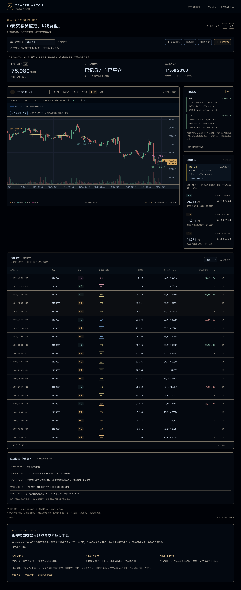

# 熬鹰K线复盘，47.241 BTC开空记录之后，还发生了什么？

原文及更新版本：[TRADER WATCH 图文文章](https://bn.9987620.xyz/articles/aoying-kline-review-btc-202610)

发布于 2026-11-07 · TRADER WATCH

关键词 · 熬鹰K线复盘 / 熬鹰资本复盘 / BTC开平仓记录 / KOL复盘

“以82,571.58 USDT开空47.241 BTC”是一条很容易记住的操作。但做熬鹰K线复盘时，还需要继续看这条记录之前和之后发生了什么。下面只讨论观察台存档中的一轮历史操作，不把它当作当前持仓或交易建议。

## 案例范围与来源

项目为币安公开带单项目“熬鹰资本”，项目ID为5075281354358777856。本文在2026-11-07核对本站已保存的公开BTCUSDT成交，选取2026-10-10至2026-10-23的三条记录。时间均为北京时间。

这是一份第三方整理的公开记录案例。它不代表币安或交易员认可本站，也不代表这个项目的全部历史。读者可以通过文末的原项目链接、本站记录接口和案例CSV继续核对。

## 先把三条记录放在一起

表格的开空和平空按SHORT方向解释，SELL是开空，BUY是平空。价格保留公开记录中的精度，数量单位为BTC。

| 北京时间 | 操作 | 数量 / BTC | 成交均价 / USDT |
| --- | --- | --- | --- |
| 2026-10-10 01:22:51 | 开空 | 48.971 | 82555.03138 |
| 2026-10-10 02:18:27 | 开空 | 47.241 | 82571.57634 |
| 2026-10-23 11:50:51 | 平空 | 96.212 | 81934.27588 |

## 47.241 BTC并不是这轮的全部开仓量

在第二笔47.241 BTC开空之前，存档里已经有一笔48.971 BTC开空。把两笔合在一起，累计开空数量为96.212 BTC。第二笔的成交均价也不能直接当作这轮的整体开仓均价。

按这两笔数量加权，开仓均价约为82,563.15511 USDT。这个结果只根据表中的两笔开仓计算，没有加入资金费、手续费或其它未列出的记录。

> 48.971 + 47.241 = 96.212 BTC。96.212 − 96.212 = 0 BTC

## 在K线上把开仓与平仓连接起来

在观察台选择熬鹰资本、BTCUSDT，然后点击这轮记录的同轮编号，可以把两次开空与10月23日的平空放到同一张图上。查看较长的区间时，使用1小时、4小时或日线，比把几周交易挤在5分钟图上更容易阅读。

连线表达按同合约、同方向与开平数量归组的推算关系。不同历史覆盖下，页面的轮次编号可能变化，核对时以日期、方向和数量为准。

BTC历史案例实图，截于2026-11-07。图表用于核对这轮已保存记录，不表示当前BTC持仓。

## 这组记录支持的结论与适用范围

这三条存档记录的开平数量能够归零，因此不能继续只拿47.241 BTC那条开仓，断言这一笔至今仍全部持有。

但一轮历史记录归零，也不能推出该账户在文章发布日期或现在完全没有仓位。后续的新操作、其它合约、其它方向以及未取得的公开记录，都需要分别检查。

- 可以核对，这组三条记录的日期、价格与开平数量。
- 可以描述，两次开空累计96.212 BTC，随后记录到等量平空。
- 不能据此断言，交易员现在空仓、正在做多或仍持有同样空单。
- 不能据此评价，只凭一轮历史结果决定是否值得跟单。

## 把同样的方法用在下一轮复盘

记住一笔大单不难，困难的是把上下文补齐。复盘时，把项目ID、完整时间范围和累计数量一起保存。先确认自己正在讨论哪一轮，再看图上的入场与退出，结论会更清楚。

## 资料与记录

- [熬鹰资本币安公开主页](https://www.binance.com/zh-CN/copy-trading/lead-details/5075281354358777856)
- [本站保存的公开BTC成交JSON（会随采集更新）](https://bn.9987620.xyz/api/trades?portfolioId=5075281354358777856&symbol=BTCUSDT)
- [本文三条历史记录CSV（固定案例）](https://bn.9987620.xyz/examples/aoying-btc-202610.csv)

[回到文章目录](../README.md) · [打开观察台](https://bn.9987620.xyz/)

[下载网站Markdown版本](https://bn.9987620.xyz/articles/aoying-kline-review-btc-202610/markdown) · [订阅图文RSS](https://bn.9987620.xyz/feed.xml)
