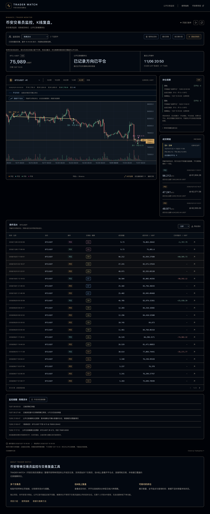

# 币安交易员 Discord 提醒：如何核对开平仓、K线和推送延迟

原文链接 https://bn.9987620.xyz/articles/binance-trader-discord-alerts

TRADER WATCH · 发布于 2026-11-18 · 更新于 2026-11-18

想在关闭网页后继续观察币安带单交易员，可以加入 TRADER WATCH 的 Discord 社群。监控目标的新公开成交由云端采集，符合推送条件的记录会发到社群频道。收到一条消息后，先按项目 ID、合约和委托时间找到对应流水，再看同轮是否还有加仓或平仓。

## 怎样订阅和核对交易员

打开观察台，选择已有交易员，或用币安带单主页链接添加监控目标。站点使用共享监控列表，先确认目标已启用。接着通过资料区的邀请链接加入 Discord，在社群频道查看公开成交提醒。

同名交易员可能对应不同项目。消息标题链接指向币安公开项目主页，可以用网址里的项目 ID 与观察台所选目标核对。

## 提醒里的几个字段怎么读

长仓与短仓分开看。比如消息写着“开空 BTCUSDT”，数量指这笔公开成交的数量。要判断这一轮后续有没有加仓或减仓，可以按同轮编号检查前后记录。

| 字段 | 核对方式 |
| --- | --- |
| 交易员与合约 | 打开消息标题链接核对项目 ID，在观察台选择同一个目标和合约。 |
| 动作、方向、数量与均价 | 与同方向的流水核对。平多或平空的成交还要结合此前数量判断是部分平仓还是全平。 |
| 委托时间 · 北京 | 用这个时间在开平仓流水和 K 线上定位。 |
| 记录更新时间 · 北京 | 用于核对上游何时更新记录。Discord 消息时间用于核对频道何时收到推送。 |

## 用熬鹰资本的历史记录走一遍

以 2026 年 10 月的 BTCUSDT 公开存档为例。北京时间 10 月 10 日 02:18:27 的委托对应 47.241 BTC 开空，成交均价为 82571.57634 USDT。在案例里，这笔成交之前还有 48.971 BTC 开空，10 月 23 日 11:50:51 又记录到 96.212 BTC 平空。点击这几笔流水中的同轮编号，就能看见它们在 K 线上的位置。

这组固定 CSV 是核对流程的历史样本。用它可以复算 48.971 + 47.241 = 96.212 BTC；仓位观察还要看后续记录和完整查询截止时间。

观察台历史案例截图，截于 2026-11-07。图中展示 2026 年 10 月的已保存流水。

## 为什么成交和 Discord 消息之间会有延迟

延迟来自上游公布记录、观察台采集和 Discord 投递。常规云端采集的最短间隔为 5 分钟，目标较多、上游限流或采集预算紧张时可能延长。网页约每 10 秒读取一次已保存状态。需要判断数据新鲜度时，比较记录更新时间、消息时间和观察台的最后完整查询时间。

如果历史流水里出现一笔新补取的旧记录，到站内按日期和合约核对。频道推送面向近期采集与对账中新收录、且记录更新时间符合启用条件的成交。按日期补取或导入的历史记录可在网页复盘。

## 关闭网页后哪些提醒还有效

Discord 频道的成交推送由云端运行，关闭观察台后仍可接收；个人是否弹出通知取决于自己的 Discord 频道和设备设置。网页内还可查看推算变化与采集状态，浏览器通知需要授权并保持页面打开。

## 资料与记录

- [加入 TRADER WATCH Discord 社群](https://discord.gg/NjXEW6mdDG)
- [观察台使用指南与采集频率说明](https://bn.9987620.xyz/guide)
- [熬鹰资本 BTCUSDT 历史案例](https://bn.9987620.xyz/articles/aoying-kline-review-btc-202610)
- [BTCUSDT 固定案例 CSV](../examples/aoying-btc-202610.csv)
