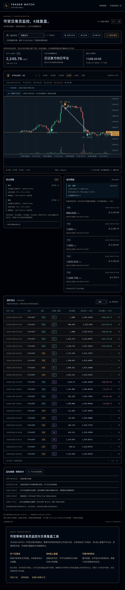

# BN交易员免费跟单怎么理解？先用K线复盘看清记录

原文及更新版本：[TRADER WATCH 图文文章](https://bn.9987620.xyz/articles/bn-free-copy-trading-review)

发布于 2026-11-07 · TRADER WATCH

关键词 · 跟单 / 交易员跟单免费 / BN交易员免费跟单 / 免费复盘工具

很多人搜“交易员跟单免费”，想找到一个能直接看懂交易员操作的入口。先把“免费”具体到一件事，看资料、使用复盘工具，以及在交易所实际跟单，是三种不同的行为。TRADER WATCH 免费提供公开记录观察与K线复盘，交易执行需要在交易所另外完成。

## 把“免费”落实到具体用途

免费看到一张收益截图，只说明这张图没有收费。它不一定包含完整的开仓、加仓、平仓，也不一定能说明回撤期间发生了什么。免费使用一个工具，则应该看清它到底能提供哪些记录。

| 你想做的事 | 要核对的内容 |
| --- | --- |
| 查看公开资料 | 交易员身份、项目ID、统计区间、资料更新时间 |
| 用免费工具复盘 | 成交时间、方向、数量、价格、历史覆盖和查询截止时间 |
| 在交易所实际跟单 | 平台可用性、交易设置、费用、利润分成及当前官方规则 |

## 免费复盘工具能帮到哪一步？

打开观察台，添加币安带单项目的主页链接，就能把已经采集到的公开成交放回K线。相同编号连接同一轮开仓、加仓和分批平仓，流水保留数量与均价。研究一轮操作时，不必在一堆独立买卖箭头之间猜对应关系。

网页会显示推算持仓及依据，也会保留“数据不足”。这对跟单前的观察很重要，工具应该告诉你自己知道多少，而不只是给出一个数字。

网站完整界面实图，截于2026-11-07。点击可查看原尺寸。图中价格和状态属于截图时刻。

## 跟单前可以按这个顺序看

先选定一个项目，完成一轮记录的核对，再扩大观察范围。这样的流程比同时盯着很多收益榜更容易留下可复查的结论。

- 核对交易员主页与项目ID，避免把同名账号混在一起。
- 查看最后完整查询时间，以及较早历史是否仍在补取。
- 选一个合约，点击同轮编号，把开仓、加仓和平仓放在一起。
- 核对累计数量能否归零，区分部分平仓和整轮结束。
- 记录自己的问题和所用时间范围，而不把历史操作当作当前指令。

## 实际交易还涉及哪些成本？

币安官方的合约跟单功能会按所选设置复制交易，并涉及其交易费用和利润分成规则。实际费用、条件和可用性应以官方当前页面为准。本站免费提供观察与复盘，不替代交易所的跟单服务，也不执行订单。

公开记录还可能延迟或缺失，行情价也不等于你能够成交的价格。复盘回答的是历史操作如何发生。是否交易、使用什么仓位，是另一个需要独立判断的问题。

## 一个能留下记录的起点

可以先从文章区选一篇具体方法，再打开观察台完成一次核对。导出的CSV、同轮编号和查询截止时间，比一句“这个交易员不错”更容易在以后检查。

## 资料与记录

- [币安合约跟单常见问题（官方）](https://www.binance.com/en/support/faq/detail/6ed0995daf0b42d5816beaf1e31ca09d)
- [TRADER WATCH 使用指南](https://bn.9987620.xyz/guide)

[回到文章目录](../README.md) · [打开观察台](https://bn.9987620.xyz/)
