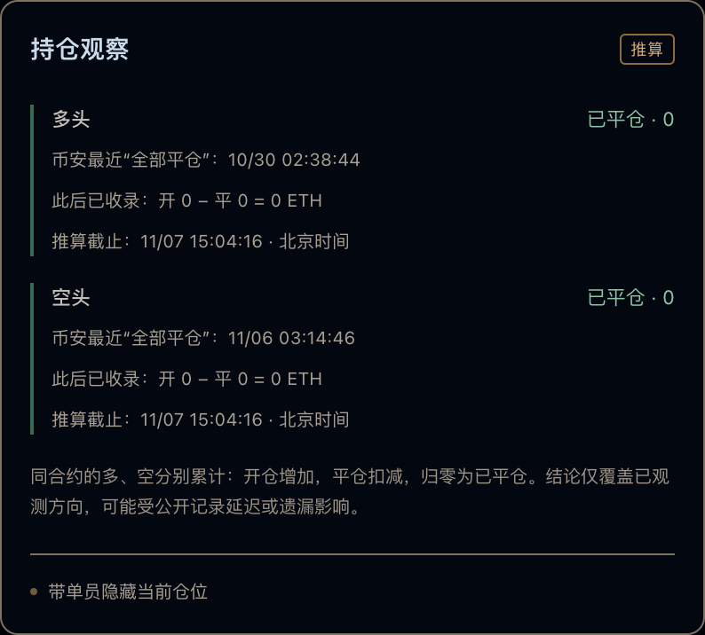

# 看到开空就代表还持仓？跟单复盘里的5个常见误区

原文及更新版本：[TRADER WATCH 图文文章](https://bn.9987620.xyz/articles/copy-trader-position-history-mistakes)

发布于 2026-11-07 · TRADER WATCH

关键词 · 交易员持仓查询 / 公开记录推算持仓 / 跟单复盘 / 开平仓记录

搜索“交易员持仓查询”，很容易期待一个确定的实时数字。公开带单记录往往只能支持带条件的判断，在什么起点之后、已覆盖到什么时刻、开平数量能否核对。忽略这些条件，再漂亮的持仓数字也可能被误读。

## 误区一，最新一条开空就是当前持仓

一条开空只证明观察到一次开仓操作。它之前可能已经有仓位，之后也可能出现加仓、部分平仓或全部平仓。还可能只是当前页面最容易看到的一条记录。

复盘时应该把同方向的上下文展开，再检查完整查询截止时间。熬鹰BTC历史案例中的47.241 BTC开空，就是需要连同前后记录一起看的例子。

## 误区二，出现平仓就已经全部退出

用一组演示数量说明，先开100，后来平60，记录内还剩40。再平40，才在这组完整记录内归零。这组演示数量用于说明开平仓的累计关系。

> 演示，100 − 60 = 40。100 − 60 − 40 = 0

## 误区三，空列表就等于账户空仓

空列表可能表示没有公开当前仓位，也可能是查询尚未完成、筛选条件没有命中，或上游暂时没有返回数据。它和已经取得全平依据、累计数量为零，是不同的情况。

观察台分别保留“推算有仓”“已平仓”和“数据不足”。读状态时，还要一起读起点、累计开平数量和截止时间。

实图中的零数量有对应起点和查询截止时间，不能把它外推为整个账户此刻没有仓位。

## 误区四，一个方向归零，整个账户就空仓

同一合约的多头与空头需要分别核对，不同合约也不能混在一起。某一轮BTC空单已结束，不代表ETH、其它合约或另一方向都没有仓位。

第三方公开记录工具无法据此发现所有隐藏仓位。结论应保持在已观察到的范围内，而不是从一个局部数字推演整个账户。

## 误区五，页面刷新快，记录就一定逐笔实时

网页读取已保存数据的频率，和云端从上游采集新记录的频率，是两层不同的过程。界面上的行情时间、最后完整查询时间和网站同步时间也各有用途。

上游限制、历史回补和云端预算都会影响可取得的数据。做KOL复盘或跟单观察时，把截图日期与查询截止时间一起留下，才能避免旧图被误当成当前状态。

## 一句更准确的复盘结论

与其写“他现在肯定还持有这笔空单”，不如写清楚，“在所示查询截止时间内，按已经覆盖的这组合约与方向记录，累计后剩余多少。仍有哪些缺口。”这样的描述既方便后续复查，也更适合与别人交流。

## 资料与记录

- [公开数据与持仓推算方法](https://bn.9987620.xyz/methodology)
- [熬鹰BTC历史案例](https://bn.9987620.xyz/articles/aoying-kline-review-btc-202610)

[回到文章目录](../README.md) · [打开观察台](https://bn.9987620.xyz/)

[下载网站Markdown版本](https://bn.9987620.xyz/articles/copy-trader-position-history-mistakes/markdown) · [订阅图文RSS](https://bn.9987620.xyz/feed.xml)
