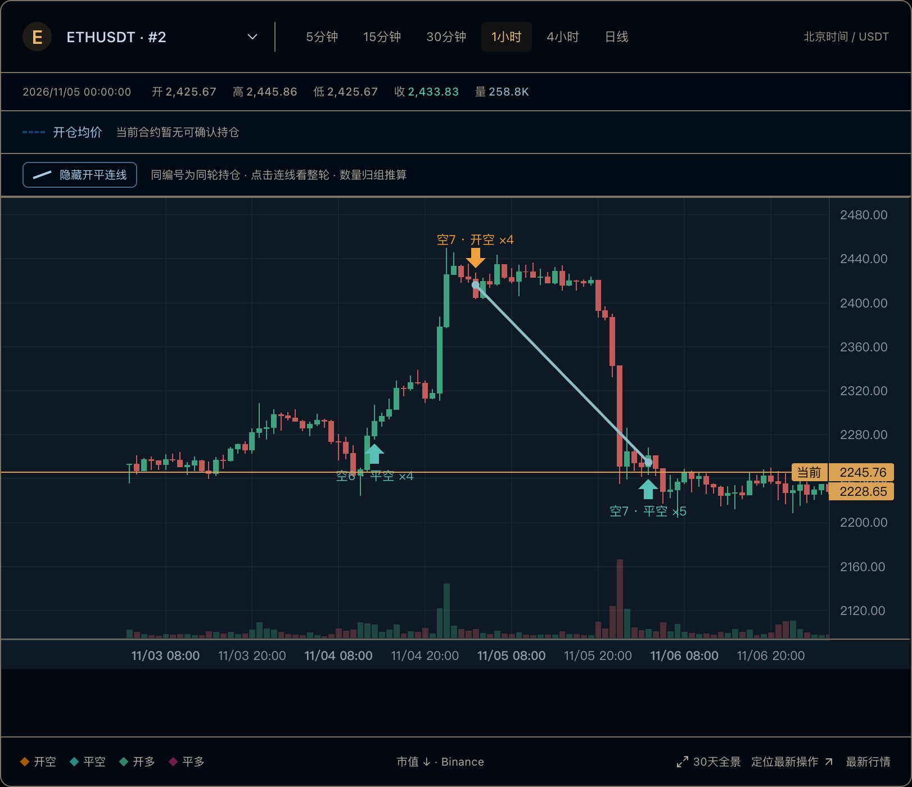

# K线复盘怎么做？把开仓、加仓和分批平仓连起来

原文及更新版本：[TRADER WATCH 图文文章](https://bn.9987620.xyz/articles/kline-review-entry-exit-connections)

发布于 2026-11-07 · TRADER WATCH

关键词 · K线复盘 / 开平仓连线 / 分批平仓 / 合约交易复盘

一张K线图上有很多买卖箭头，并不一定更容易复盘。开仓和加仓属于哪一轮？哪几次减仓对应同一批仓位？先把记录按方向与数量归组，再连接起来，才能减少看混。

## 先确定正在复盘的交易周期

在TRADER WATCH中，同一交易员、同一合约、同一多空方向的操作按数量归组，数量归零后结束一轮。图上标记和流水用同轮编号对应，点击编号可以定位整轮。

理解这种关系需要同时查看成交方向与数量。多头买入通常表示开仓，空头买入则可能是平空。必须同时看多空方向和BUY/SELL字段。

## 把图和流水一起看

先点击一轮编号，确认选中的成交数量与时间范围，再看对应K线。图表负责把价格变化和操作时间放在一起，流水负责保留每笔的精确数量与成交价。两者结合，才容易发现一轮交易中间的加仓和分批退出。

网站历史实图，相同“空7”编号连接这轮开仓与分批平仓。该图为ETH示例，与BTC历史案例分开阅读。

## 区分四种价格

单笔成交价属于某一次执行。加权开仓均价由数量与成本推算。平仓成交价属于退出操作。图上“当前”报价则属于页面取到行情的时刻，历史截图中的该字段以后不会自动更新。

部分平仓按比例减少剩余数量与成本。此后继续加仓时，要用剩余数量和新的成交重新加权，不能一直用第一笔开仓价代替。

## 按一轮交易的持续时间选择周期

网站支持5m、15m、30m、1h、4h和1d。短周期适合把较近的操作展开看，较长周期方便观察跨越多日的记录。这里说的是阅读方式，不是在推荐交易周期。

定位一轮很长的历史操作时，分钟线可能超出单次行情范围。可以先切到1小时或4小时确认全貌，再缩小到需要研究的一段。不要因为屏幕只显示一部分，就把其余操作从复盘结论中排除。

## 什么情况下不应该强行连线？

缺少开仓、平仓量超过已观察开仓、同一时间内开平顺序不明，都可能让配对不可靠。遇到这些情况，观察台会保留未配对说明。

同根K线还可能包含多笔操作，标记上的数量表示合并展示。需要精确复核时，回到流水逐笔核对。

## 复盘笔记可以只回答三个问题

这一轮由哪些已知记录组成？仓位数量怎样变化？哪些问题仍然缺少数据？先把这三个问题回答清楚，再讨论自己的交易观察。一条好看的连线本身不是收益承诺。

## 资料与记录

- [K线复盘工具使用指南](https://bn.9987620.xyz/guide)
- [同轮归组与价格计算方法](https://bn.9987620.xyz/methodology)

[回到文章目录](../README.md) · [打开观察台](https://bn.9987620.xyz/)
