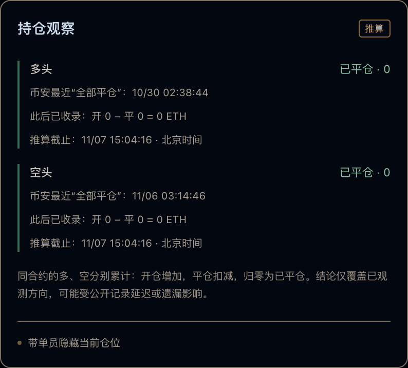

# KOL复盘怎么做？跟单前先核对这6项交易记录

原文及更新版本：[TRADER WATCH 图文文章](https://bn.9987620.xyz/articles/kol-trade-review-checklist)

发布于 2026-11-07 · TRADER WATCH

关键词 · KOL复盘 / 交易复盘 / 跟单前复盘 / 币安实盘复盘

看到一张盈利截图，很容易把注意力放在最后赚了多少。真正能复查的KOL复盘，需要把过程留下来，这个项目是谁、记录覆盖到哪里、仓位如何变化，以及当时看到的是什么行情。下面六项可以作为一张复盘清单。

## 1. 先核对项目身份

保存交易员主页链接与项目ID，名称只用来帮助识别。同名昵称、改名、不同带单项目都可能让资料混在一起。复盘某位KOL时，文章或笔记应该明确自己观察的是哪个公开项目。

TRADER WATCH 按项目分别保存记录和提醒。切换交易员后，先核对顶部目标，再看合约和日期。

## 2. 查看数据覆盖与查询截止时间

先找页面的完整查询时间、历史回补进度和错误提示。某个日期区间分页完成，只说明这个区间已经查完，并不说明交易员全部历史完整。

如果一篇复盘只写“现在持仓多少”，却没有查询截止时间和缺口说明，读者很难知道这个判断什么时候还能成立。把时间写清楚，本身就是复盘的一部分。

持仓依据面板实图，先看起点和截止时间，再理解“已平仓”或“数据不足”。截图状态不代表此刻账户状态。

## 3. 把一轮交易的数量算完

同一个合约的多单和空单分开核对。从可靠起点累计开仓，扣减平仓，再看是否还有剩余。一次平仓可能只是减掉一部分，一条开仓也可能只是某一轮的第二次加仓。

> 记录内剩余数量 = 可靠起点之后的累计开仓数量 − 累计平仓数量

## 4. 看加仓路径，而不只看首次入场

把首次开仓、后续加仓和分批平仓放回同一条时间线。相同的最终均价，可能来自完全不同的过程。先把发生过的操作描述清楚，再讨论自己的观察。

图表同轮连线适合做这一步，点击流水编号定位整轮，检查开仓点、加仓点和退出点。遇到未配对记录，保留疑问，不把缺少的信息补成一个完整故事。

## 5. 区分原始时间、行情与执行结果

记录里的原始下单时间与委托更新时间可能不同。K线显示的价格、接口成交价和另一位跟单者的实际成交也不能直接画等号。

引用实图时，写明合约、K线周期、时区和截图日期。历史图里的“当前”报价只是截图时刻的页面字段，不应在以后被当成实时行情。

## 6. 留下一份别人能复查的笔记

一份简洁笔记可以包括，项目链接、合约与方向、观察区间、开平数量表、K线截图、查询截止时间、尚未解释的问题。需要继续研究时，导出CSV保留原记录。

这些材料用于描述已观察到的交易过程，不是对KOL未来收益的保证。一次完整复盘也不等于对交易员整体表现的评价。

## 资料与记录

- [公开数据与持仓推算方法](https://bn.9987620.xyz/methodology)
- [观察台使用指南](https://bn.9987620.xyz/guide)

[回到文章目录](../README.md) · [打开观察台](https://bn.9987620.xyz/)
